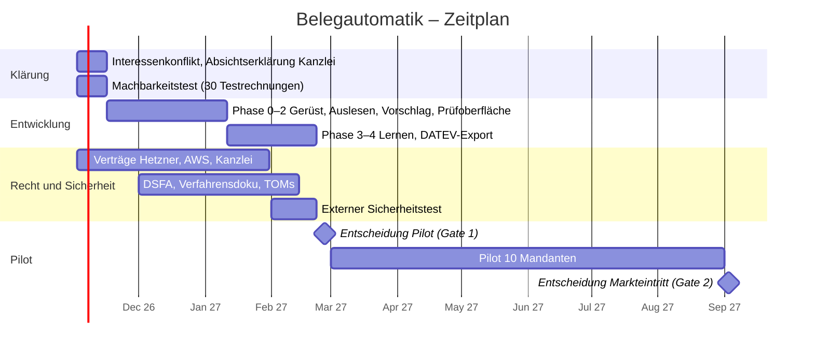

# Projektplan – Simply Done AI: Belegautomatik

Stand: 28.10.2026 · Projektleitung: Paul Graß (Simply Done AI) · Planung: Claude
Grundlage: `CLAUDE.md`, `docs/protokoll.md`, `docs/recherche/2026-10-28_recht-hosting-ki.md`

---

## 1. Ergebnis der Machbarkeitsprüfung

**Das Projekt ist umsetzbar.** Technik, Recht und Wirtschaftlichkeit tragen. Die Risiken liegen nicht im Code, sondern in Kapazität, Verträgen und im Wettbewerb mit DATEV.

| Bereich | Bewertung | Begründung |
|---|---|---|
| Technik | Machbar | Alle Bausteine existieren: Texterkennung, E-Rechnungs-Parser, Claude über Bedrock EU, Object Lock bei Hetzner. Mit Claude Code ist ein erstes lauffähiges Produkt in ca. 4 Monaten realistisch. |
| Revisionssicherheit | Machbar | Im Pilot bleibt DATEV das Archiv, unser System ist ein Vorsystem mit lückenlosem Änderungsprotokoll. Für den Verkauf an andere Kanzleien später ein Software-Testat nach IDW PS 880. |
| Datenschutz und Berufsrecht | Machbar mit Aufwand | Vertragskette nach § 62a StBerG und § 203 StGB, Pseudonymisierung vor jedem KI-Aufruf, EU-Verarbeitung. Neu laut BStBK-FAQ vom 27.10.2026: Einwilligung der Mandanten für den Pilot einholen. |
| Wirtschaftlichkeit | Sehr gut | KI-Kosten ca. 0,02 € pro Beleg (Rechnung in Abschnitt 7). Selbst bei 0,20 € Verkaufspreis bleibt viel Marge, und der Preis liegt weit unter cisbox (0,70 €). |
| Wettbewerb | Größtes Marktrisiko | Die Kanzlei hat mit dem DATEV Automatisierungsservice bereits eine Alternative im eigenen System. Simply Done AI muss im Pilot nachweislich besser sein. |
| Kapazität | Größtes Projektrisiko | Paul arbeitet hauptberuflich in der Kanzlei. Ohne feste Wochenstunden zieht sich das Projekt. |

---

## 2. Was du jetzt wissen musst

1. **Zeitplan:** Erstes Produkt bis Ende Februar 2027, Pilot März bis August 2027, Entscheidung über den Markteintritt im September 2027. Voraussetzung: 10–15 Stunden pro Woche.
2. **Interessenkonflikt offen ansprechen.** Du bist Angestellter der Kanzlei und Geschäftsführer des Anbieters. Das muss Markus Pfaar schriftlich wissen und billigen, sonst ist der Pilot angreifbar (Nebentätigkeit, Neutralität bei der Anbieterauswahl).
3. **Keine Kanzleidaten in privaten Werkzeugen.** Die BStBK-FAQ stellt klar: private KI-Konten für berufliche Zwecke sind nicht zulässig. Entwicklung nur mit Testdaten, echte Belege erst im Pilot auf dem Hetzner-Server mit allen Verträgen.
4. **Der Pilot ist ein Vergleichstest gegen DATEV.** Dieselben Mandanten, dieselben Messgrößen. Das ist die einzige Zahl, die Markus Pfaar und später andere Kanzleien überzeugt.
5. **Die Rechtsspur startet sofort und läuft parallel.** Das AWS-Zusatzdokument zu § 203 hat den längsten Vorlauf.

---

## 3. Phasen und Zeitplan

### Phase A – Klärung und Machbarkeitstest (02.11.–15.11.2026)

| Aufgabe | Ergebnis |
|---|---|
| Gespräch mit Markus Pfaar nach dem Machbarkeitstest (spätestens 27.11.2026): Projekt, Rollen, Interessenkonflikt | Schriftliche Absichtserklärung (Letter of Intent) für den Pilot: Umfang, Datenschutz, Preis im Pilot, Abbruchrecht |
| Konten bei AWS (Bedrock `eu-central-1`, einmaliges Anthropic-Formular) und STACKIT (AI Model Serving) anlegen; beide ohne Grundgebühr | Zwei KI-Anbieter für den Vergleich |
| Claude Code einrichten: geschäftliches Konto, Trainings-Einstellung aus | Saubere Entwicklungsumgebung |
| **Machbarkeitstest:** 30 Testrechnungen (KoSIT-Testsuite + selbst erzeugte PDFs/Scans) durch Texterkennung und zwei KI-Anbieter schicken (Claude über Bedrock, offene Modelle bei STACKIT) | Messwert je Anbieter: Wie viele Kopfdaten und Positionen werden korrekt ausgelesen? Entscheidung, ob AWS überhaupt gebraucht wird |

**Abbruchkriterium Phase A:** Weniger als 90 % korrekt ausgelesene Pflichtfelder bei sauberen PDFs. Dann Architektur überdenken, bevor Geld und Zeit fließen.

### Phase B – Entwicklung Kern (16.11.2026–10.01.2027)
Phasen 0–2 aus der `CLAUDE.md`: Projektgerüst, Audit-Log, Eingang, Auslesen, Pseudonymisierung, Steuerlogik, Sonderfälle, Prüfoberfläche.
Ab Tag 1 mitbauen: **automatischer Qualitätstest** mit einem Goldstandard von mindestens 200 Testbelegen, damit jede Änderung messbar besser oder schlechter ist.

### Phase C – Lernen und DATEV (11.01.–21.02.2027)
Phasen 3–4: Lernregeln, Import der Buchungshistorie, Branchen-Regelwerk für 5 Startbranchen, DATEV-Export als CSV.
Startbranchen nach Häufigkeit im Mandantenstamm der Kanzlei wählen (WZ-Codes aus DATEV).

### Gate 1 – Entscheidung über den Pilot (Ende Februar 2027)
Pilot startet nur, wenn **alle** Punkte erfüllt sind:
- [ ] Alle Verträge aus Abschnitt 4 unterschrieben
- [ ] Externer Sicherheitstest ohne offene kritische Befunde
- [ ] Verfahrensdokumentation und Datenschutz-Folgenabschätzung fertig
- [ ] Einwilligung der 10 Pilot-Mandanten liegt vor
- [ ] Goldstandard: mindestens 95 % korrekte Kopfdaten, mindestens 80 % korrekte Kontierung bei Testbelegen
- [ ] DATEV-Import der Exportdatei in Kanzlei-Rechnungswesen fehlerfrei

### Phase D – Pilot (März–August 2027)
- 10 Mandanten aus mindestens 4 Branchen, über 6 Monate (Vorschlag Markus Pfaar).
- **Vergleich:** Für jeden Pilot-Mandanten wird gemessen, wie viele Vorschläge unverändert übernommen werden, bei Simply Done AI und beim DATEV Automatisierungsservice.
- Monatlicher Bericht an Markus Pfaar mit den Messgrößen.

### Gate 2 – Entscheidung über den Markteintritt (September 2027)
| Ergebnis | Entscheidung |
|---|---|
| Übernahmequote mindestens 10 Prozentpunkte über DATEV und Zeitersparnis messbar | Markteintritt: IDW-PS-880-Testat beauftragen, Vertrieb an weitere Kanzleien |
| Etwa gleichauf mit DATEV | Nur weiter, wenn Preis oder Branchenfunktion klar überlegen sind; sonst Spezialisierung (z. B. Kanzleien ohne Unternehmen Online) |
| Schlechter als DATEV | Projekt beenden oder als internes Werkzeug weiterführen |

---

## 4. Rechtsspur (parallel, Start sofort)

| Nr. | Aufgabe | Wer | Bis |
|---|---|---|---|
| R1 | Interessenkonflikt offenlegen, Nebentätigkeit schriftlich genehmigen lassen | Paul, Markus Pfaar | 15.11.2026 |
| R2 | § 203-Vereinbarung und AVV bei Hetzner anfordern | Simply Done AI | 30.11.2026 |
| R3 | § 203-Vereinbarung beim gewählten KI-Anbieter: bei STACKIT direkt anfragen; bei AWS über einen AWS-Partner (Bedrock-Abdeckung festhalten). Anfrage parallel zum Machbarkeitstest | Simply Done AI | Anfrage bis 15.11.2026, Abschluss bis 31.01.2027 |
| R3a | Anwaltlich prüfen lassen, ob die Pseudonymisierung allein ausreicht (EuGH C-413/23 P, BStBK-FAQ KI) | Anwalt | 31.01.2027 |
| R4 | Vertrag Kanzlei ↔ Simply Done AI: AVV + Vereinbarung nach § 62a StBerG + Haftungsregelung | Anwalt (IT-/Berufsrecht) | 31.01.2027 |
| R5 | Einwilligungserklärung für Pilot-Mandanten (laut BStBK-FAQ bei mandatsbezogener KI-Nutzung ratsam) | Anwalt, Kanzlei | 15.02.2027 |
| R6 | Datenschutz-Folgenabschätzung, Verzeichnis der Verarbeitungstätigkeiten, technische und organisatorische Maßnahmen, Löschkonzept | Simply Done AI, Datenschutzbeauftragter der Kanzlei | 15.02.2027 |
| R7 | Verfahrensdokumentation nach GoBD für das Vorsystem | Simply Done AI | 15.02.2027 |
| R8 | KI-Kompetenz nach Art. 4 AI Act: kurze Schulung der Pilot-Sachbearbeiter, dokumentiert | Simply Done AI | 28.02.2027 |
| R9 | Versicherungen: IT- und Cyber-Haftpflicht für Simply Done AI; Kanzlei prüft ihre Berufshaftpflicht auf KI-Einsatz | beide | 28.02.2027 |

**Rückfallebene zu R3:** Kommt das AWS-Addendum nicht rechtzeitig, läuft der Pilot mit einem lokalen Open-Source-Modell auf einem Hetzner-GPU-Server. Die Architektur ist dafür vorbereitet (`LLMProvider`). Die Qualität vorher im Goldstandard messen.

---

## 5. Revisionssicherheit – Strategie in zwei Stufen

| Stufe | Wann | Was |
|---|---|---|
| 1 – Vorsystem | Pilot | Belege und Buchungen landen per Belegtransfer und CSV-Import in DATEV. DATEV ist das revisionssichere Archiv. Unser System hält Originale unveränderbar (Object Lock), protokolliert jede Änderung und hat eine eigene Verfahrensdokumentation. |
| 2 – Eigenständiges Produkt | Nach Gate 2 | Software-Testat nach IDW PS 880 durch einen Wirtschaftsprüfer. Kanzleien und Betriebsprüfer fragen danach. Später ISO 27001 für den Betrieb. |

Ein Testat ist erst sinnvoll, wenn das Produkt stabil ist; jede größere Änderung kann eine Nachprüfung auslösen.

---

## 6. Datenschutz – technische Pflichtpunkte

Bereits in der `CLAUDE.md` als feste Regeln verankert:
- Pseudonymisierung vor jedem KI-Aufruf, Claude nur über Bedrock EU, kein Fable
- Hosting nur in Deutschland, eigene Verschlüsselung, zweite Sicherung an anderem Standort
- Kein mandantenübergreifendes Lernen aus Rohdaten
- Zwei-Faktor-Anmeldung, Rechte je Sachbearbeiter und Mandant
- Logs ohne Belegdaten

Zusätzlich vor dem Pilot:
- Externer Sicherheitstest (Penetrationstest) der Anwendung und des Servers
- Notfallplan: Wer wird bei einem Sicherheitsvorfall wie schnell informiert (DSGVO: 72 Stunden an die Aufsichtsbehörde)

---

## 7. Kosten und Wirtschaftlichkeit

Konkrete Preise je Anbieter und Stufe: `docs/kosten.md`.

### KI-Kosten pro Beleg (berechnet)
Claude Sonnet 5.5 kostet 2 $ je Million Eingabe-Token und 10 $ je Million Ausgabe-Token.

| Annahme je Beleg | Token | Kosten |
|---|---|---|
| Eingabe (pseudonymisierter Text, Kontenliste, Anweisungen) | 5.000 | 0,010 $ |
| Ausgabe (strukturierte Positionen und Vorschlag) | 800 | 0,008 $ |
| **Summe** | | **ca. 0,018 $ ≈ 0,02 €** |

Bei 50.000 Belegen pro Monat sind das rund 900–1.000 € KI-Kosten. Mit wiederverwendbarem Zwischenspeicher für die Kontenliste (Prompt-Caching) wird es günstiger. Der Bedrock-Preis kann leicht abweichen; vor dem Pilot im AWS-Preisrechner prüfen.

### Weitere Kostenblöcke (grobe Schätzung ohne Quelle, Angebote einholen)
| Posten | Wann | Größenordnung |
|---|---|---|
| Hetzner Server und Speicher im Pilot | laufend | niedriger dreistelliger Betrag pro Monat |
| Claude-Konto für die Entwicklung | laufend | Team- oder Max-Tarif |
| Anwalt IT- und Berufsrecht (Verträge R4, R5) | einmalig | niedriger vierstelliger Betrag |
| Externer Sicherheitstest | einmalig | mittlerer vierstelliger Betrag |
| Versicherung IT- und Cyber-Haftpflicht | jährlich | dreistelliger bis niedriger vierstelliger Betrag |
| IDW-PS-880-Testat | nach Gate 2 | fünfstelliger Betrag |

### Preisrahmen
cisbox: 0,70 € pro Beleg. Selbstkosten Simply Done AI im Betrieb voraussichtlich unter 0,05 € pro Beleg. Ein Preis zwischen 0,20 und 0,35 € wäre klar günstiger als cisbox und lässt Raum für Support, Testat und Vertrieb. Der Vergleich mit dem DATEV-Preis (aus der Preisliste der Kanzlei) fehlt noch und entscheidet die endgültige Spanne.

---

## 8. Rollen

| Rolle | Wer | Aufgabe |
|---|---|---|
| Auftraggeber und Produktverantwortung | Paul Graß (Simply Done AI) | Entscheidungen, Prioritäten, Abnahme |
| Pilot-Sponsor | Markus Pfaar (Kanzlei) | Freigabe Pilot, Auswahl Mandanten, Gate-Entscheidungen |
| Fachliche Prüfung | 1–2 Sachbearbeiter der Kanzlei | Testen der Vorschläge, Rückmeldung zu Sonderfällen |
| Entwicklung | Claude Code | Umsetzung nach `CLAUDE.md` |
| Planung, Recherche, Dokumentation | Claude | Projektplan, Protokoll, Recherchen, Entscheidungsvorlagen |
| Datenschutz | Datenschutzbeauftragter der Kanzlei | DSFA, Prüfung der Verträge |
| Extern | Anwalt, Sicherheitstester, später Wirtschaftsprüfer | Verträge, Sicherheitstest, Testat |

---

## 9. Risiken

| Risiko | Wahrscheinlichkeit | Auswirkung | Gegenmaßnahme |
|---|---|---|---|
| Zu wenig Zeit neben dem Hauptberuf | hoch | Verzögerung | Feste Wochenstunden einplanen; Phasen klein halten; Claude Code für Routinearbeit |
| DATEV-Service ist gut genug | mittel | Kein Markt | Vergleichstest im Pilot; Alleinstellung Branchen-Regelwerk und Positionsaufteilung |
| AWS-Addendum kommt nicht | mittel | Kein Claude im Pilot | Lokales Modell als Rückfallebene; kostet in Deutschland mindestens 1.499 € pro Monat (Hetzner GEX131), günstiger nur in Helsinki |
| Interessenkonflikt wird zum Problem | mittel | Pilot gestoppt | Früh offenlegen, schriftlich regeln |
| Fehlbuchungen durch KI | mittel | Haftung, Vertrauensverlust | Freigabe durch Menschen, Steuerlogik als geprüfter Code, Versicherung |
| Sicherheitsvorfall | niedrig | sehr hoch | Pseudonymisierung, Verschlüsselung, Sicherheitstest, Notfallplan |
| DATEV-Online-Schnittstellen nicht zugänglich | mittel | Weniger Komfort | CSV-Import reicht für den Pilot |

---

## 10. Die nächsten 14 Tage

| Nr. | Aufgabe | Bis |
|---|---|---|
| 1 | Feste Projektzeit pro Woche festlegen und in den Kalender eintragen | 01.11.2026 |
| 2 | Gespräch mit Markus Pfaar mit Machbarkeitstest-Bericht und kleiner Demo; Interessenkonflikt offenlegen, Absichtserklärung vereinbaren. Vor einer Entscheidung der Kanzlei für einen cisbox-Test | spätestens 27.11.2026 |
| 3 | Preis des DATEV Automatisierungsservice aus der Kanzlei-Preisliste holen | 06.11.2026 |
| 4 | Konten bei AWS (Bedrock EU) und STACKIT anlegen | 06.11.2026 |
| 5 | § 203-Unterlagen bei Hetzner und AWS-Partner anfragen | 15.11.2026 |
| 6 | Claude Code im Projektordner starten: Machbarkeitstest mit 30 Testrechnungen | 15.11.2026 |

---

## Quellen
- [BStBK: FAQ zum Einsatz von KI, Stand 27.10.2026](https://www.bstbk.de/downloads/bstbk/digitalisierung/BStBK_FAQ-KI_end.pdf)
- [Claude Sonnet 5.5: Preise und Veröffentlichung (computingforgeeks)](https://computingforgeeks.com/claude-sonnet-5-5-released-features-benchmarks/)
- [KoSIT: XRechnung-Testsuite mit Beispielrechnungen (Apache-2.0)](https://github.com/itplr-kosit/xrechnung-testsuite)
- [Rödl & Partner: IDW PS 880 Softwareprüfung](https://roedl.com/services/audit/it-audit-it-assurance-it-advisory/it-assurance/idw-ps-880)
- Weitere Quellen zu Recht und Hosting: `docs/recherche/2026-10-28_recht-hosting-ki.md`
